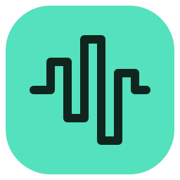

<p></p>

# Audio Router

A Windows app that copies audio from **one or more running applications**, mixes it with your microphone, and sends the mix to a game, voice chat, meeting, or other app through a virtual microphone. Your usual speaker output and Windows volume keys keep working.

## Features

- Check multiple running applications, including minimized/background audio apps, and add/remove sources while live.
- Mix its sound with a physical or processed microphone.
- Control outgoing music from **0–200%**, independently of listening volume.
- Pause application audio while voice continues, or mute the microphone separately.
- Change microphone/cable while live, with a brief routing restart.
- Optionally enable microphone, application, and output meters with **Live meters**. They are off by default and pause when the window is hidden/minimized.
- Follow a numbered setup guide with Windows sound-settings and Volume mixer buttons.
- Close to the system tray to keep audio routing active; restore or exit from the tray menu.
- Refresh the application/device list manually, without recurring discovery scans.
- Process audio locally, without recording or uploading it.

## Run

**Requires Windows 11 22H2 or later, x64**, and a destination app that accepts a selectable microphone. Portable builds include the .NET runtime.

Download `AudioRouter-win-x64.zip` from the repository's Releases page when a release is available, extract it, and open `AudioRouter.exe`. Build archives are also available from successful **Windows build** workflow runs. Until then, use the build instructions below; they produce `artifacts/AudioRouter-win-x64/AudioRouter.exe` and the portable ZIP.

Install [VB-CABLE](https://vb-audio.com/Cable/) once. The application's **Setup guide** and [QUICKSTART.txt](QUICKSTART.txt) walk through configuration. The driver needs administrator access and may require a restart. Audio Router itself runs without elevation.

1. Keep your usual speakers/headphones as Windows' output and your real microphone as its input. Check these after driver installation because the vendor installer may change defaults.
2. In Audio Router, check the applications you want to share, choose your microphone and **CABLE Input**, then click **Start routing**.
3. In the destination game/app's Audio, Voice, or Microphone settings, choose **CABLE Output** as its input and keep the normal speaker output. Alternatively use **Windows Settings → System → Sound → Volume mixer → Apps → destination app → Input device**, where available. Some apps manage their own input devices; prefer their own selector when Windows routing is unavailable or ignored.
4. Enable its microphone/voice chat and use a mic test or another listener to confirm both voice and music.

The **Setup guide** and **How to set up any app** button show these steps in the app. See [the detailed setup guide](docs/SETUP.md) for per-app routing, matching cable pairs, and troubleshooting.

Checked apps continue playing normally. Their copied audio and your voice reach the destination app through VB-CABLE. The Windows master speaker volume controls only what you hear; the Music slider controls all checked apps in the transmitted mix. Source-app playback controls may still change their captured copies.

**Music sent to others** ranges from 0% to 200% and controls all checked apps together. 100% uses their captured levels; 200% applies 2× gain (+6 dB) to the combined application audio, without changing your listening level or microphone gain. The output limiter contains peaks, so already-loud sources have less room to boost. App selections and levels are remembered across restarts and retained when switching devices. Older single-app preferences are migrated automatically.

**Pause music:** uncheck Share application audio; your microphone continues. **Close to tray:** the × button hides the window and keeps the current route working. Click the tray icon or choose **Open Audio Router** to restore it. Opening the executable again also restores the existing instance. **Stop everything:** click **Stop routing**, or choose **Exit Audio Router** from the tray menu to stop and quit. The destination app remains on the virtual microphone, so choose the real microphone there to talk without Audio Router. Routing never starts automatically on launch.

The app loads applications/devices once at launch. Click **Refresh** after opening an app or connecting a device. The **Live meters** preference is saved; turning it off hides both bars and live dB readings and disables peak measurements and the meter UI timer. Static slider percentages remain visible. Metering also pauses while in the tray or minimized, and when routing is stopped.

Saved devices, gains, and source preferences from the former Voice Router name are read on first use. New settings are stored under `%LOCALAPPDATA%/AudioRouter` without overwriting an existing Audio Router profile.

Browsers share all audible tabs/windows. Apps can be checked before they produce sound. Adding or unchecking one app leaves the mic and other captures active. A source that closes or fails is unchecked independently; other sources and voice continue, with no replacement silently selected. Refresh and check the source again after reopening it. Searching does not change checked selections. Headphones avoid acoustic echo. Leave Windows “Listen to this device” off for the cable.

Microphone and output dropdowns remain usable while routing is live. Choosing another device briefly restarts the route with the same application, levels, and mute/pause state. If the new device cannot open, routing stops and the selectors remain usable for recovery. Fresh setup prefers the regular **CABLE Input** pair; a saved explicit choice is preserved. The separate **CABLE In 16ch** pair needs **CABLE Out 16ch** in the destination app. The setup guide follows the selected pair.

## Build and verify

Install the [.NET 10 SDK](https://dotnet.microsoft.com/download/dotnet/10.0), then run in PowerShell:

```powershell
.\build.ps1 -Test -Publish
.\run.ps1
```

The script also recognizes a project-local SDK at `.tools/dotnet/dotnet.exe`. `global.json` pins SDK 10.0.402 with patch roll-forward. Source dependencies are pinned to NAudio 3.3.0. The portable ZIP, quick start, licenses, and executable checksum are written to `artifacts/`.

GitHub Actions runs the same Windows build/test/package script for pushes and pull requests. It uploads the portable ZIP and test reports; it does not create releases automatically. See [CONTRIBUTING.md](CONTRIBUTING.md) for development and first-push commands, and [development notes](docs/DEVELOPMENT.md) for architecture and hardware diagnostics.

The solution contains a platform-independent float mixer and settings store, a Windows WASAPI/device/process layer, the WPF app, tests, and a diagnostic console. The test suite covers frame-aligned buffering, clock drift bounds, independent gains, pause/mute, stale-source removal, limiting, application-root matching, settings recovery, and startup/disposal failures.

Additional diagnostics (use the project-local dotnet path instead of `dotnet` if needed):

```powershell
dotnet run --project tools/AudioRouter.Diagnostics -c Release -- --inventory
dotnet run --project tools/AudioRouter.Diagnostics -c Release -- --verify-loopback
dotnet run --project tools/AudioRouter.Diagnostics -c Release -- --verify-volume
dotnet run --project tools/AudioRouter.Diagnostics -c Release -- --probe-microphone
dotnet run --project tools/AudioRouter.Diagnostics -c Release -- --probe-app 1234 3
```

`--verify-loopback` launches two quiet (-60 dBFS) test-tone processes and checks that capture includes only the selected process. `--verify-volume` additionally lowers and mutes the current speaker endpoint temporarily and restores its previous volume and mute in a `finally` block. Run it when brief listening-volume changes are acceptable. Other diagnostics never change endpoint settings. Probes report aggregate levels without saving audio.

The UI supports `--smoke-test <absolute-output.png>`: it exercises search/gain/pause/mute controls, renders the main and setup windows to PNG, writes a JSON report, then exits. It does not start routing or persist test settings.

`--device-switch-smoke-test <absolute-output.png>` additionally opens real audio streams (mic muted, music sharing paused), changes both dropdowns while live, checks the actual route's device IDs and retained source/levels/mutes, exercises an unavailable microphone and recovery, then stops and exits without saving preferences. This check requires two available microphones and two VB-CABLE render endpoints.

## Audio design

- WASAPI process-loopback capture includes each checked application's child processes. Each application owns independent capture streams and mix buffers, so removal or failure does not restart healthy sources. Duplicate app/process selections are normalized. Sources are discovered through visible windows and render-endpoint audio sessions, grouped by executable and application root, with PID creation-time checks. Capturing never expands to an Explorer/system-wide ancestor.
- Microphone and app capture request 48 kHz stereo float in shared mode. Windows handles microphone and output format conversion. Audio is mixed on the render clock, with 100 ms bounded input queues, a 60 ms backlog limit, silence on underflow, short gain ramps, and a soft output limiter.
- Output goes only to a detected VB-CABLE render endpoint. Its recording endpoint cannot be selected as the microphone, preventing direct cable feedback. There is no speaker monitoring or system-loopback fallback.
- The real-time callbacks do not use the UI thread. Device loss stops routing with a visible error. Application closure/capture failure removes application audio while preserving the mic. Stop and explicit tray Exit release every stream, including partially initialized sessions; hiding the window leaves the route intact.
- The router never calls APIs that change Windows device defaults, endpoint volume/mute, source-app volume, per-app device assignments, or destination-app configuration. The diagnostic volume check is explicitly separate.

Settings and bounded error logs live in `%LOCALAPPDATA%/AudioRouter`. Audio stays in memory and is neither saved nor uploaded. There are no cloud services, startup tasks, browser extensions, or game hooks.

## Practical limits

VB-CABLE must be installed before routing can start. The build does not install drivers or change audio settings. Whole-browser capture includes tabs you may not intend to share, so pause unrelated audio. Protected/exclusive audio or unusual application pipelines may not be capturable. A destination app's voice processing can reduce music fidelity; test in the actual receiving app. Latency depends on the selected devices, virtual cable, destination app, and voice chat; the app requests 20 ms capture / 30 ms render buffers without promising a network-inclusive latency.

## License

Audio Router is released under the [MIT license](LICENSE). NAudio and the bundled .NET runtime retain their own licenses; see [third-party notices](THIRD-PARTY-NOTICES.md). VB-CABLE is a separate VB-Audio product and is not bundled or automatically installed.
